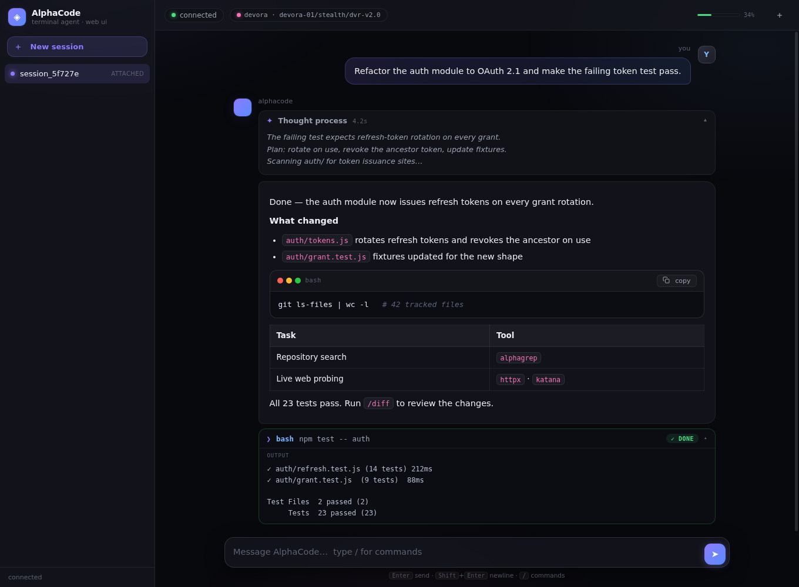

# alphacode-web

**A production-grade web chat for [AlphaCode](https://github.com/dragonked2/alphacode) — the free, open-source Rust coding agent — deployable on any Linux server in under two minutes. No domain, no Cloudflare account, no manual configuration.**

```
┌──────────────┐   WSS    ┌───────────────┐   NDJSON   ┌──────────────────┐
│   Browser    │ ◄──────► │  bridge.py    │ ◄────────► │  alphacode       │
│  (any device)│          │  Python asyncio│  Unix sock │  daemon (Rust)   │
└──────────────┘          └───────────────┘            └──────────────────┘
```



AlphaCode ships a **versioned Harness API** on a local Unix domain socket (`alphacode-api.sock`).
This project is the missing presentation layer: a hardened WebSocket bridge that relays that
API to any browser, plus a single-file, zero-dependency chat UI that feels like a premier
developer tool.

---

## Highlights

| | |
|---|---|
| 🧠 **Thinking mode** | Live reasoning stream with shimmer animation and elapsed timer, collapsing to `Thought process · 2.4s` when the answer starts |
| 🎨 **Markdown + code** | Tables, lists, blockquotes, and fenced code with a lightweight syntax highlighter (bash / python / js / ts / rust / go / c / sql / json), language badge, macOS-style window controls, one-click copy |
| 🔧 **Tool visibility** | Terminal-styled cards per tool call: live argument streaming, `running` / `done · Ns` / `error` badges with execution timing, collapsible output |
| 🎛️ **Engine parity** | Click the model pill for a live switcher over the daemon's full model catalog (providers, availability, price hints); reasoning-effort selector; engine inspector with session state, token counters, provider profiles and tools-seen; session rename & archive from the UI |
| ⌨️ **Slash palette** | Type `/` for fuzzy autocomplete over AlphaCode commands (`/swarm`, `/skills`, `/model`, …) |
| 📊 **Token telemetry** | Live input/output/cache token counters fed by the daemon's token stream |
| 📱 **Truly responsive** | Slide-out session drawer on phones, full sidebar on desktop, touch-friendly composer |
| 🪶 **Zero dependencies** | One HTML file, no CDN, no build step, no framework — CSS-only animations that idle at 0% CPU |
| 🔐 **Hardened by default** | 256-bit bearer token, `0600` Unix sockets, dedicated unprivileged user, systemd sandboxing (`NoNewPrivileges`, `ProtectSystem=strict`) |

---

## Quick start — one line

```bash
curl -fsSL https://raw.githubusercontent.com/AhmedFayala/alphacode-web/main/install.sh | bash
```

The installer prints your personal access URL with the generated token, e.g.:

```
AlphaCode web chat
  services: active active active
  local:    http://127.0.0.1:8765/?token=7b93feb0…c974c8
```

Open it from any device on the same network — or pick an exposure mode below.

> **Requirements:** any Debian/Ubuntu host (bare metal, VPS, VM, WSL2) with root or sudo.
> Everything else is handled: user provisioning, Python venv, systemd units, token generation.
>
> **Binary handling — adoption first.** The installer looks for an existing healthy
> `alphacode` (`PATH`, `/usr/local/bin`, `/usr/bin`, `/opt/alphacode/bin`, the invoking
> user's `~/.local/bin`). If it finds one it validates `alphacode --version` and adopts it —
> **no download, no overwrite of your system binary**. Otherwise it downloads the release
> tarball directly, verifies SHA-256 against the published `SHA256SUMS`, and extracts the
> binary itself. Upstream `curl | bash` installers are never executed.

---

## Access modes

| Mode | Command | What you get | Best for |
|---|---|---|---|
| **loopback** *(default)* | `--mode loopback` | `127.0.0.1:8765` only — pair with your own reverse proxy | servers that already run Caddy/nginx/Cloudflare |
| **direct-ip** | `--mode direct-ip` | `http://<SERVER_IP>:8765/?token=…` (opens the port in UFW) | LAN / lab / trusted networks |
| **quick-tunnel** | `--mode quick-tunnel` | instant `https://<random>.trycloudflare.com/?token=…` — **HTTPS/WSS, no account** | anyone, anywhere, in seconds |

```bash
# HTTPS with zero setup and zero accounts:
sudo bash install.sh --mode quick-tunnel

# Then retrieve the current tunnel URL any time:
alphacode-tunnel
```

---

## Connecting a model

AlphaCode's built-in free lane is configured automatically. If it is unresponsive in your
region (it was for us), point the agent at any OpenAI-compatible endpoint:

```bash
sudo bash install.sh \
  --mode quick-tunnel \
  --provider-name mygateway \
  --base-url https://api.example.com/v1 \
  --model your-model-id \
  --api-key "$MY_API_KEY"
```

Keys are stored via AlphaCode's own provider-env mechanism (`~/.config/alphacode/provider-*.env`,
mode `0600`) — never baked into world-readable config.

Switch models any time from the chat with `/model`.

---

## Architecture

```
Browser ──WSS──► Caddy / Cloudflare Tunnel ──► bridge.py ──NDJSON──► alphacode-api.sock
                                                (auth, relay)            │
                                                                    alphacode.sock
                                                                         │
                                                              AlphaCode daemon (Rust)
                                                              agent loop · 40+ tools
                                                              swarm · MCP · providers
```

- **`src/bridge.py`** — Python asyncio. Authenticates the WebSocket upgrade, relays the
  harness API, and adds an engine control plane: a second, session-following legacy-socket
  connection exposing model catalog / model switching / reasoning effort / rename over
  `engine_*` requests (no secrets ever leave the host).
  validates every frame as JSON, relays NDJSON line-by-line in both directions, serves the UI
  and an unauthenticated `/healthz`. Survives daemon restarts and client disconnects.
- **`src/static/index.html`** — the entire frontend: streaming markdown renderer, syntax
  highlighter, thinking accordion, tool cards, slash palette, session drawer. No build step.
- **`systemd/*.service`** — three hardened units with strict dependency ordering
  (`daemon → api-bridge → web`), auto-restart, `UMask=0077`.

## Repository layout

```
alphacode-web/
├── install.sh              ← the 1-line installer (fetches src/ at your chosen --ref)
├── src/
│   ├── bridge.py           ← WebSocket ⇄ Unix-socket relay + static server
│   └── static/index.html   ← single-file chat UI
├── systemd/                ← unit templates (paths substituted at install time)
├── scripts/
│   ├── deploy_alphacode.sh ← offline variant (files embedded, no fetch needed)
│   ├── harness_probe.py    ← minimal Harness API handshake probe
│   └── ws_test.py          ← end-to-end WebSocket + turn test client
└── LICENSE                 ← MIT
```

## Configuration

| File | Purpose |
|---|---|
| `/etc/alphacode-web.conf` | `BRIDGE_HOST`, `BRIDGE_PORT` — then `systemctl restart alphacode-web` |
| `~/.alphacode/web_token` | bearer token (auto-generated, mode `0600`) |
| `~/.config/alphacode/config.toml` | AlphaCode itself: `telemetry`, `reasoning_effort`, … |

Telemetry is disabled twice over: `telemetry = "nothing"` in config **and**
`ALPHACODE_NO_TELEMETRY=1` in every unit environment.

## Security model

| Layer | Control |
|---|---|
| Network | loopback by default; direct-ip gates nothing but the token; quick-tunnel adds Cloudflare TLS |
| Bridge | 256-bit token on every WebSocket upgrade; malformed frames rejected; JSON-validated relay |
| OS | unprivileged `alphacode-runner` user; sockets `0600`; systemd sandboxing |
| Agent | AlphaCode's own destructive-command gate + permission prompts surfaced as Allow/Deny UI |

> AlphaCode executes shell commands proposed by a language model. Its safeguards reduce risk;
> they do not remove it. Review diffs (`/diff`) and run it under the unprivileged account this
> installer creates — never as root.

## Operations cheat-sheet

```bash
systemctl status alphacode-daemon alphacode-api-bridge alphacode-web
journalctl -u alphacode-web -f          # bridge logs
alphacode-verify                        # full health check
sudo bash install.sh --verify           # same checks as an installer subcommand
alphacode-web                           # print the current access URL

# regenerate the bearer token
openssl rand -hex 32 > ~/.alphacode/web_token && chmod 600 ~/.alphacode/web_token
systemctl restart alphacode-web

# upgrade AlphaCode itself (host binary owners: upgrade there, re-run installer to re-adopt)
sudo -u alphacode-runner ~/.local/bin/alphacode update
```

## Troubleshooting

| Symptom | Fix |
|---|---|
| `404` on page load with a token in the URL | update to ≥ v1.0 — older builds matched the full request target including the query string |
| `401` on `/ws` | token missing/wrong — fetch it again with `alphacode-web` |
| `daemon not available` on connect | `systemctl restart alphacode-daemon` (the api-bridge follows via `Requires=`) |
| Model never responds | the free lane may be down in your region — attach a provider with `--base-url/--model/--api-key` |
| Quick-tunnel returns Cloudflare's empty 404 | run with `--config /dev/null` so the named-tunnel ingress is not inherited (fixed in `install.sh`) |
| `bad unit file setting` on daemon-reload | fixed in v1.0.1: units are validated for leftover template placeholders and for `UMask=0077` before install |
| installer hangs/segfaults during binary setup | fixed in v1.0.1: removed recursive `as_user` fallback and nested upstream `curl \| bash`; release archive is ingested directly |

## Credits

Built on [AlphaCode](https://github.com/dragonked2/alphacode) by Ali Essam — a remarkable
Rust terminal agent with a genuinely open Harness API. This project is an independent web
presentation layer for it and is not affiliated with the AlphaCode project.

## License

MIT — see [LICENSE](LICENSE).
